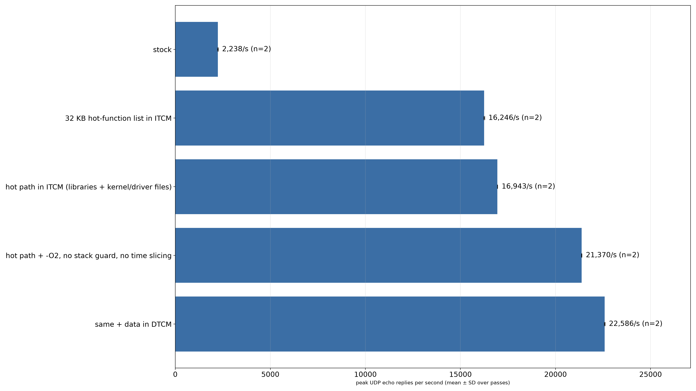
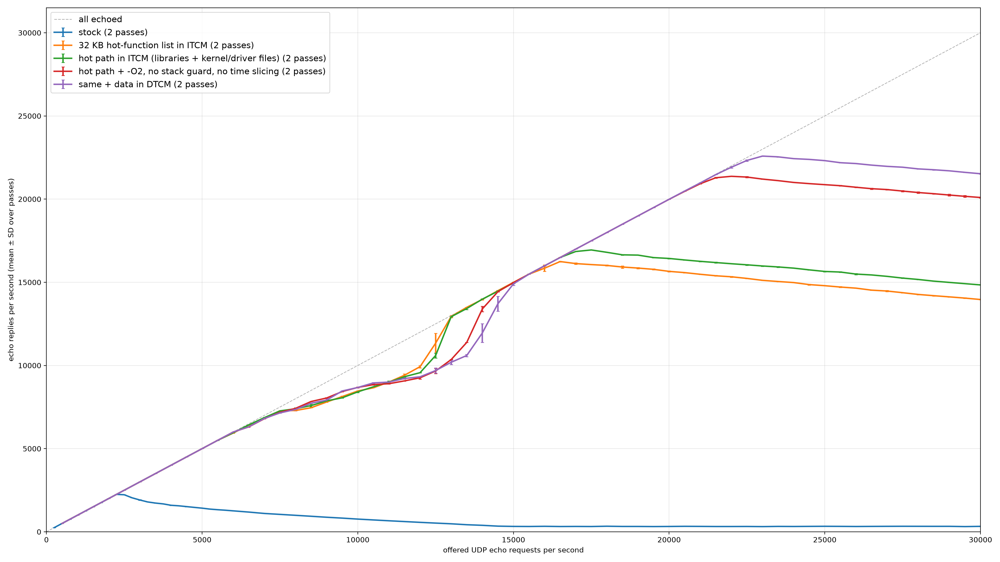

# USB UDP echo: code placement benchmark

The board takes the address 192.0.2.1/24 on a USB CDC-NCM interface (CDC-ECM with `ecm.overlay`) and echoes every UDP datagram that arrives on port 4242 (buffer 1500 bytes). The host measures the echo rate with `tools/udp_echo_sweep.py`. Only the placement of the code and the configuration change between builds; the source stays the same.

Boards with files in `boards/`: `teensy41` (console and shell on a USB CDC ACM port in the same device; shell command `bootloader` enters the Teensy HalfKay loader), `rpi_pico` (console on UART0).

## Build variants

From a Zephyr workspace (`ZEPHYR_BASE` set), with this repository as an extra module:

```sh
M=/path/to/zephyr-codeplace
S=$M/samples/usb_udp_echo
# stock
west build -p -b teensy41 -d build/stock $S -- -DEXTRA_ZEPHYR_MODULES=$M
# network + USB libraries, kernel, arch and EHCI driver files in ITCM (66 KB)
west build -p -b teensy41 -d build/hot $S -- -DEXTRA_ZEPHYR_MODULES=$M -DEXTRA_CONF_FILE=$S/placement/hot-path.conf
# + -O2, no MPU stack guard, no time slicing; + all RAM data in DTCM
west build -p -b teensy41 -d build/fast-dtcm $S -- -DEXTRA_ZEPHYR_MODULES=$M \
    -DEXTRA_CONF_FILE="$S/placement/hot-path.conf;$S/placement/tuning.conf" \
    -DEXTRA_DTC_OVERLAY_FILE=$S/placement/teensy41-dtcm.overlay
# portable alternative: 32 KB of hot functions by name
west build -p -b teensy41 -d build/list32 $S -- -DEXTRA_ZEPHYR_MODULES=$M \
    -DEXTRA_CONF_FILE=$S/placement/list.conf -DCODEPLACE_LIST=$S/placement/teensy41-list32.cmake
# on-target PC sampler (not with the DTCM overlay)
west build -p -b teensy41 -d build/pcs $S -- -DEXTRA_ZEPHYR_MODULES=$M \
    -DEXTRA_CONF_FILE="$S/placement/hot-path.conf;$S/placement/pc-sampler.conf"
# Raspberry Pi Pico: network + USB libraries in SRAM (CONFIG_SAMPLE_HOT_PATH_REGION defaults to RAM)
west build -p -b rpi_pico -d build/pico-hot $S -- -DEXTRA_ZEPHYR_MODULES=$M -DEXTRA_CONF_FILE=$S/placement/hot-path.conf
```

Kconfig of the sample: `CONFIG_SAMPLE_HOT_PATH_LIBS` (libraries), `CONFIG_SAMPLE_HOT_PATH_FILES` (i.MX RT files, `placement/imxrt-hot-files.cmake`), `CONFIG_SAMPLE_HOT_PATH_REGION` (`ITCM` on i.MX RT, `RAM` otherwise). `-DCODEPLACE_LIST=<file.cmake>` includes a function list made by `python -m codeplace pick`; the list in `placement/` was made from a stock profile of a similar test application and still works here, which is the point of a name list.

## Run

1. Flash (Teensy: `bootloader` in the shell, then `teensy_loader_cli --mcu=TEENSY41 -w build/.../zephyr/zephyr.hex`).
2. Give the host side of the USB interface 192.0.2.2/24 (for example a NetworkManager profile with a static address).
3. `python3 tools/udp_echo_sweep.py out.jsonl --rates 500:30000:500` (32-byte payload; `--payload 1000` for large datagrams). Repeat with a fresh flash for each pass.

## Results (Teensy 4.1, CDC-NCM, Zephyr main of 2026-10-31)

| Variant | Fast memory | Peak UDP echo (32 B, 2 passes) |
|---|---|---|
| stock | 0 | 2,238/s |
| `list32` (32 KB function list) | 32 KB ITCM | 16,246/s |
| `hot` (`hot-path.conf`) | 66 KB ITCM | 16,943/s |
| `fast` (+ `tuning.conf`) | 77 KB ITCM | 21,370/s |
| `fast-dtcm` (+ DTCM overlay) | 77 KB ITCM + data in DTCM | **22,586/s** (10.1×) |

1000-byte datagrams, echoed in full (1 pass): stock 1,678/s, `fast-dtcm` 10,812/s (10.8 MB/s in each direction).




Open point (not analysed): in all ITCM variants some replies are missing between about 6,500 and 14,000 requests/s offered (round trip rises to about 300 µs), and above 14,500/s everything is echoed again. A test application with `poll()` and non-blocking batch reads did not show this on the same board. 🥦 Host CDC-NCM aggregation (several datagrams per transfer) against the small receive packet pool (`CONFIG_NET_PKT_RX_COUNT=8`) and the one-at-a-time blocking loop. Stock CDC-NCM collapses beyond its peak (to about 300/s).

Notes: the `-O2`/no-stack-guard/no-time-slicing tuning is worth little while the code still runs from flash; measure it after placement. Without the stack guard a stack overflow is no longer detected. Do not set `CONFIG_NET_TC_RX_COUNT=0`/`TX_COUNT=0` for throughput: lower latency, but a third less throughput and collapse under overload (measured in the companion test application).
